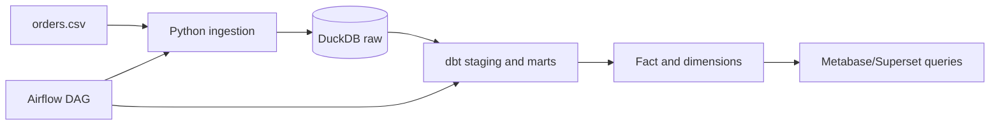

# Project 1 - Batch ELT Warehouse

## Architecture



The pipeline uses an append-only raw layer, a typed/deduplicated staging view,
and an incremental `fact_orders` model. `order_id` is the business key and
`updated_at` is the incremental watermark. dbt tests cover `unique`,
`not_null`, and dimension relationships.

## Run

```bash
docker compose up --build
```

Or locally:

```bash
pip install -r requirements.txt
python scripts/ingest.py
dbt build --project-dir dbt --profiles-dir dbt
```

Airflow runs ingestion and dbt with three retries and a five-minute delay.
`dashboard/queries.sql` contains starter Metabase/Superset queries.
